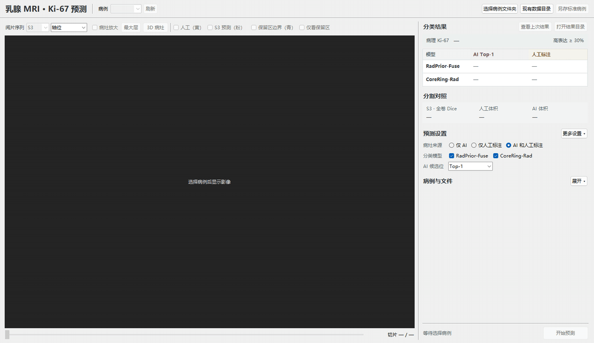
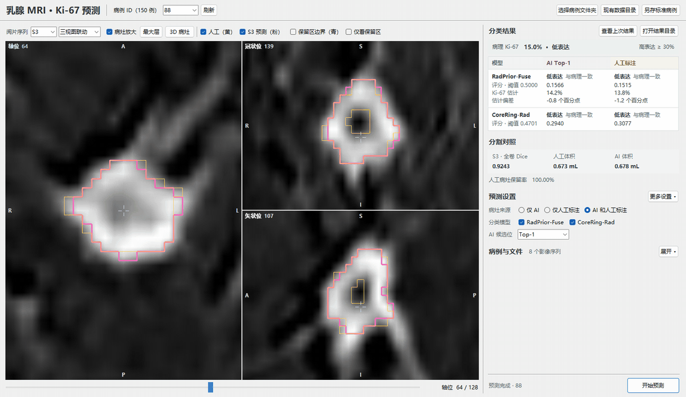
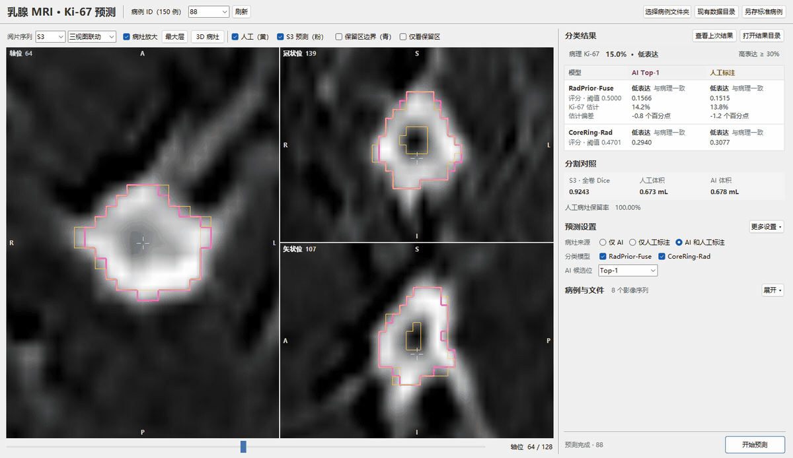

# Breast Lesion Segmentation and Ki-67 Prediction from Multiphase MRI

**Algorithm Lead** · Collaboration with Jinzhou Affiliated Hospital · Apr–Nov 2026

I developed a working desktop app for running MRI inference and reviewing the results directly in its graphical interface. It supports linked axial, coronal and sagittal views, slice-by-slice inspection, and 3D comparison of manual and automated segmentations.

## Methods and test-set results

- **Lesion segmentation.** Used TotalSegmentator MRI organ masks to constrain the search region, a 3D residual U-Net to localise lesions, and a modified Swin UNETR to delineate them. Mean whole-volume Dice was **0.858** on the test set.
- **Multiphase fusion.** Encoded the differences between each of the other four DCE-MRI phases and the reference phase (S3) with shared 3D convolutions, then fused the features into the S3 segmentation backbone with spatial gates.
- **Ki-67 prediction.** Developed a logistic regression model using 12 intratumoural and peritumoural radiomic features and a fusion network using five DCE-MRI phases plus ADC, DWI and T2. The fusion network achieved test AUROCs of **0.838** with manual masks and **0.778** with automated masks.

## App demos

### Inference and slice review

Select case ID 88, run inference, then scroll through neighbouring slices to inspect the lesion contours.

### Linked three-plane navigation

Move the crosshair around the lesion in the axial view and see the corresponding coronal and sagittal views update.

### 3D lesion comparison

Open the 3D lesion viewer, compare the manual and automated surfaces, and rotate their overlay.

